# Architecture

## 1. System overview

```
Browser (Blade + Bootstrap 5 + vanilla JS modules)            Mobile / integrations
  │  page loads (HTML)        │ AJAX (JSON, CSRF)                    │ Bearer token (Sanctum)
  ▼                           ▼                                      ▼
routes/web.php ──────── middleware stack ─────────────────── routes/api.php (/api/v1)
  auth → approved → verified.setting → two-factor → permission:<module.action>
  │
  ▼
Controllers (thin)  ──►  FormRequests / validation  ──►  Policies (record-level)
  │
  ▼
Domain services (all business rules, DB transactions)
  InventoryService · VehicleCostService · ServiceJobService · InvoiceService · PaymentService
  AttendanceService · PayrollService · DashboardService · ReportService · VinDecoderService
  OtpService · Sms\SmsManager (provider interface) · SettingsService · BackupService · AuditLogger
  │
  ▼
Eloquent models (+ Auditable trait)  ──►  MySQL 8 / MariaDB
  │
  ├── Queue (database driver): notifications, invoice emails, reminders
  ├── Scheduler: overdue refresh, reminders, backups, retention
  └── Storage: public disk (photos) · private local disk (documents, attachments, backups)
```

### Request pipeline
| Layer | Responsibility |
|---|---|
| `SecurityHeaders` | X-Frame-Options, nosniff, referrer policy, `Permissions-Policy: camera=(self)`, HSTS on HTTPS |
| `MaintenanceMode` | App-level maintenance (admins keep access) |
| `approved` (`EnsureAccountApproved`) | Pending → pending page; rejected/suspended/disabled → signed out; API → 403 |
| `verified.setting` (`EnsureVerified`) | Enforces email / SMS verification when enabled in settings |
| `two-factor` (`EnsureTwoFactor`) | 2FA challenge per session; forces setup when policy = required |
| `permission:*` (Spatie) | Page/action permission per route |
| Policies | Record-level: service jobs (assigned only), attendance (own), tasks (own), payslips (own + approved), users (super-admin protection) |
| `Gate::before` | Super Administrator holds every permission |

### Frontend
* `resources/js/core/datatable.js` – one reusable server-side table (search, filters, sort, pagination 10/25/50/100, column chooser, presets, bulk actions, export/print, table ↔ card view, URL sync, loading/empty/error states).
* `core/selects.js` – Tom Select remote searchable dropdowns backed by `/lookup/{type}` (permission-checked).
* `core/http.js` – fetch wrapper (CSRF, JSON errors → field errors + toasts), AJAX forms (`data-ajax`), action links (`data-method`).
* `pages/dashboard.js` – AJAX dashboard + Chart.js; `pages/forms.js` – invoice/PO line items, payment allocation, theme live preview, attendance modal…
* `vin-scanner.js` – html5-qrcode barcode scanning + tesseract.js OCR, VIN check-digit validation, server-side decode.
* Reusable Blade components: `x-datatable`, `x-filters`, `x-page-header`, `x-modal`, `x-status`, `x-form.*` (input, select, textarea, switch, remote).

## 2. Cross-module data rules

| Event | Effects (single DB transaction) |
|---|---|
| Vehicle created | Stock number generated (locked sequence), status history row, cost columns computed |
| Part line added to a service job | `InventoryService` locks the part row, refuses negative stock, decrements per-location + total stock, writes `stock_movements` (job_issue) → job totals → vehicle `parts_cost` / `total_investment` |
| Part line removed / job cancelled / job deleted | Stock returned (job_return), costs recomputed |
| Job status change | Repair jobs map to vehicle repair status (in_progress→Under Repair, completed→Repair Completed, quality_checked→Ready for Dispatch, delivered→Dispatched) with history; company stock toggles `in_repair` ↔ `available` |
| Invoice issued | PART lines deduct stock (sale); VEHICLE lines lock the vehicle, refuse double sale, mark Sold with price/buyer; SERVICE_JOB lines link the job (job parts are **not** deducted twice) |
| Invoice edited (no payments) / voided | Side effects reversed then re-applied / reversed (sale_return, vehicle back to available) |
| Payment / deposit | Allocations ≤ invoice balance (locked rows), totals must match; invoice amount_paid/balance/status recomputed; vehicle payment fields synced |
| Refund / reversal | Refund ≤ allocated − prior refunds; reversal keeps the record, restores balances; refunds must be reversed before their payment |
| Financing | Financed amount stays a **lender receivable** (`payment_status = pending`, customer balance 0); cash only on settlement (`financing_settlement` payment) |
| Vehicle costs | `purchase_price + parts (job part lines) + labor (repair non-part lines) + interior (interior non-part lines) + detailing (cleaning non-part lines) + other (manual expenses)` — each source counted once |
| Payroll | Rate effective at period start (history preserved); daily + weekly overtime thresholds; draft → approved (locked) → closed when fully paid |

Money is always computed in integer cents (`App\Support\Money`) and stored as `DECIMAL(14,2)`.

## 3. Database relationship design

```mermaid
erDiagram
    users ||--o{ login_histories : has
    users ||--o{ user_approval_requests : has
    users ||--o{ otp_codes : has
    users ||--o{ notification_settings : has
    users ||--o| employees : "linked to"
    users }o--o{ roles : "model_has_roles"
    roles }o--o{ permissions : "role_has_permissions"
    users ||--o{ audit_logs : writes

    customers ||--o{ vehicles : owns
    customers ||--o{ invoices : billed
    customers ||--o{ payments : pays
    customers ||--o{ service_jobs : requests
    suppliers ||--o{ vehicles : "sold us"
    suppliers ||--o{ parts : supplies
    suppliers ||--o{ purchase_orders : receives
    suppliers ||--o{ supplier_payments : paid

    vehicles ||--o{ vehicle_images : has
    vehicles ||--o{ vehicle_documents : has
    vehicles ||--o{ vehicle_status_histories : has
    vehicles ||--o{ vehicle_expenses : has
    vehicles ||--o{ vehicle_inspections : has
    vehicles ||--o{ service_jobs : serviced
    vehicles ||--o{ invoices : "invoiced for"
    vehicles }o--|| vehicle_statuses : "repair_status (slug)"
    vehicles }o--o| invoices : "sale_invoice"

    part_categories ||--o{ parts : groups
    parts ||--o{ part_images : has
    parts ||--o{ part_compatibilities : fits
    parts ||--o{ part_stocks : "per location"
    stock_locations ||--o{ part_stocks : holds
    parts ||--o{ stock_movements : ledger
    purchase_orders ||--o{ purchase_order_items : contains
    parts ||--o{ purchase_order_items : ordered

    departments ||--o{ employees : contains
    employees ||--o{ employee_pay_rates : "rate history"
    employees ||--o{ attendance_records : clocks
    payroll_periods ||--o{ payroll_entries : contains
    employees ||--o{ payroll_entries : earns
    payroll_entries ||--o{ employee_payments : "paid by"
    employees ||--o{ employee_tasks : assigned

    service_jobs ||--o{ service_job_items : lines
    service_jobs ||--o{ service_job_employees : crew
    employees ||--o{ service_job_employees : works
    service_jobs ||--o{ service_job_images : photos
    service_types ||--o{ service_job_items : catalog
    parts ||--o{ service_job_items : issued
    service_jobs }o--o| invoices : billed

    invoices ||--o{ invoice_items : lines
    invoices ||--o{ payment_allocations : receives
    payments ||--o{ payment_allocations : allocates
    payments ||--o{ payments : "refund_of"
    invoices ||--o| financing_records : financed
```



Other tables: `settings` (key/value, secrets encrypted), `api_integrations` (encrypted credentials), `integration_logs`, `saved_filters`, `custom_fields`, `attachments` (polymorphic, private), `number_sequences` (gap-free numbering with row locks), `notifications`, `jobs`, `sessions`, `personal_access_tokens`, Spatie permission tables.

Conventions: foreign keys with `restrict` for financial parents and `nullOnDelete`/`cascadeOnDelete` elsewhere; soft deletes on customers, suppliers, vehicles, parts, employees, users, service jobs, invoices, purchase orders; indexes on every filter/sort column; unique constraints on VIN, stock number, SKU, part number, document numbers.

## 4. Folder structure

```
app/
  Console/Commands/      autoshop:create-admin, sync-permissions, payment-reminders, refresh-statuses, backup, prune
  Contracts/             SmsProvider interface
  Exports/               ArrayExport (Excel)
  Http/
    Controllers/         one controller per module (+ Admin/, Auth/, Api/)
    Middleware/          approval, verification, 2FA, maintenance, security headers
    Requests/            Vehicle, Part, Customer, Supplier, Invoice, StorePayment requests
    Resources/           API resources
  Models/ (+ Concerns/)  Eloquent models, Auditable & HasAttachments traits
  Notifications/         registration, approval, low stock, OTP, invoice, reminder, receipt, task, login alert
  Policies/              record-level authorisation
  Providers/             runtime settings, rate limiters, gates, query macros
  Services/ (+ Sms/)     domain services (see §1)
  Support/               Money, NumberGenerator, DataTable, Exporter, Uploads, Vin, Barcode, helpers
config/autoshop.php      defaults, permission matrix, default roles, enums, checklists
database/
  migrations/            system, parties, vehicles, parts, HR, service & billing tables
  seeders/               SystemSeeder (reference data), DemoDataSeeder (optional, [DEMO])
  factories/
resources/
  css/app.css            theme tokens + layout
  js/                    app.js, core/*, pages/*, vin-scanner.js
  views/                 layouts, partials, components, one folder per module, PDFs, emails (vendor/mail)
routes/web.php · api.php · console.php (schedule)
tests/Feature · tests/Unit
docs/
```

## 5. Implementation phases (as delivered)

| Phase | Scope | Key verification |
|---|---|---|
| 1 | Setup, schema, auth, approval, RBAC, settings | AuthTest, PermissionTest |
| 2 | Dashboard, vehicles, images, VIN scanner | VehicleTest, ReportsDashboardTest, browser flow |
| 3 | Parts, suppliers, stock movements, purchase orders | InventoryTest |
| 4 | Employees, attendance, payroll | PayrollTest |
| 5 | Repair / interior / wash & detailing jobs | ServiceJobTest |
| 6 | Customers, invoices, payments, financing, reports | InvoicePaymentTest, ReportsDashboardTest |
| 7 | API, notifications, security, optimisation, docs | PermissionTest (API), SmokeTest (every page + export), MySQL + SQLite runs, headless-browser crawl (0 JS errors) |
